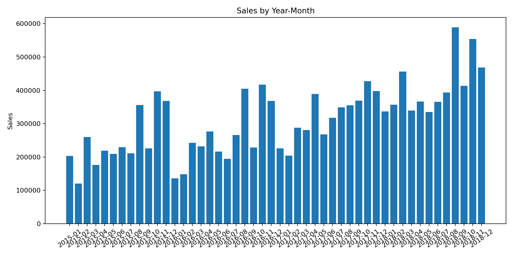
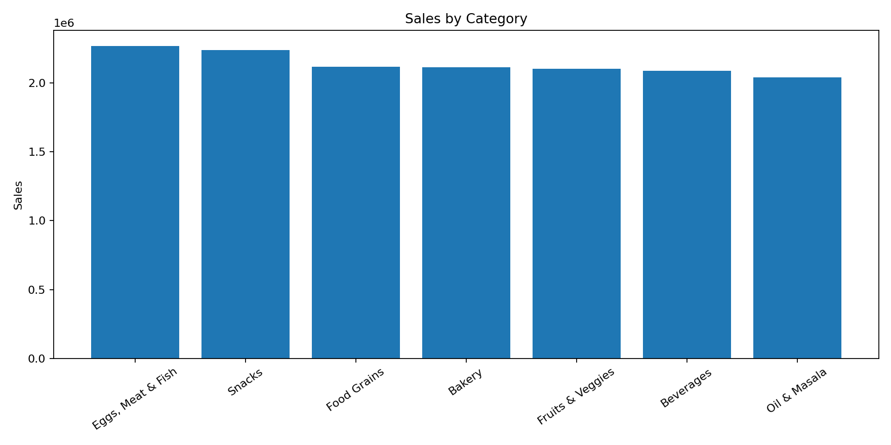
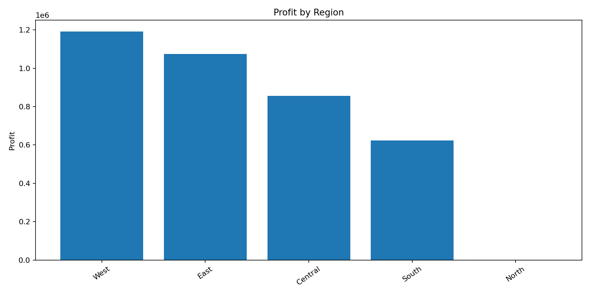
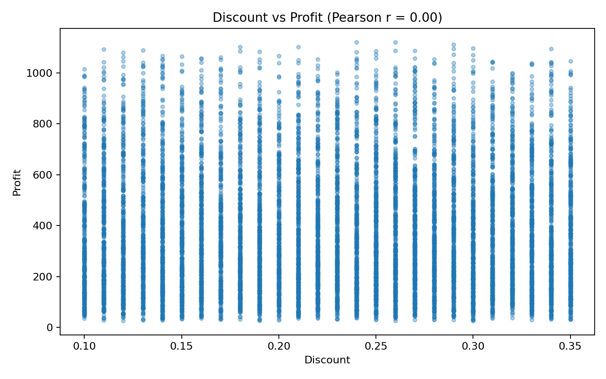

# Supermart Grocery Sales: Sales & Profitability Analysis

**Python · Pandas · Matplotlib · Power BI** | Data analysis / BI portfolio project

An exploratory analysis of 9,994 grocery sales transactions (2015–2018). It looks at how revenue and profit vary by time, product category and region, and whether discounting is associated with profit. Python handles cleaning, validation and analysis. Power BI is used for interactive reporting.

## Key findings

| Metric | Value |
| --- | ---: |
| Sales records | 9,994 (each row is a unique order) |
| Total sales | 14,956,982 |
| Total profit | 3,747,121 |
| Overall profit margin | 25.1% |
| Sales growth, 2015 → 2018 | +67% (≈19% per year) |

1. **Growth is accelerating.** Annual sales rose from 2.98M (2015) to 4.98M (2018). Growth was +5% in 2016, +24% in 2017 and +29% in 2018, and profit grew in step.
2. **Sales are strongly seasonal.** September to December brings in **42% of annual sales**, and November is the strongest month across all four years. January and February are the weakest, at about 12% combined. That pattern points to stock and staffing planning built around Q4.
3. **Region drives the differences, category doesn't.** West and East account for **61% of sales**. By contrast, the seven product categories each contribute 13.6–15.2% of sales. Profit margins are nearly flat everywhere (24.4–25.6% by category and by region), so volume, not pricing or mix, separates the strong segments from the weak ones.
4. **Discount shows no relationship with profit.** Discounts range evenly from 10% to 35%, and the row-level Pearson correlation with profit is about 0.00. This is an association check only. It does not measure the causal effect of discounting.

> Values are in the dataset's own units, with no currency conversion. The dataset has no Quantity field, so a row is a sales record, not a count of items sold.

## Visuals









## Data quality notes

- **Mixed date formats.** Hyphenated dates are `DD-MM-YYYY` and slashed dates are `MM/DD/YYYY`. Pandas' generic `format="mixed"` parser misreads the ambiguous hyphenated dates, so the script parses each format explicitly. This is a dataset-specific assumption.
- **"North" region has a single record** (sales of 1,254). It appears in grouped outputs but should be treated as a data anomaly, not a real market.
- **`Customer Name` is not a reliable customer ID**, so customer-level metrics are approximate.
- No missing values, duplicate rows or invalid dates remained after parsing.
- The near-uniform spread of categories, margins and discounts suggests the data may be synthetic. Findings show how to analyze retail data rather than describe a real retailer.

## Methods

- **Pandas:** schema validation, date parsing, aggregation by category, sub-category, region, year, month and weekday, aggregate profit margins (total profit ÷ total sales, not an average of row margins), and correlation checks.
- **Matplotlib:** bar charts, a year × month profit heatmap and scatter plots. Summary tables are exported to CSV.
- **Power BI:** DAX measures for sales, profit, margin, orders, average order value and year-over-year change, plus a calendar table for time intelligence.

## Data source

[Supermart Grocery Sales – Retail Analytics Dataset](https://www.kaggle.com/datasets/mohamedharris/supermart-grocery-sales-retail-analytics-dataset) by Mohamed Harris on Kaggle. See the dataset page for licensing.

The raw CSV is not redistributed here. Download it and save it in the repository root as `Supermart Grocery Sales - Retail Analytics Dataset.csv`, or pass a different path with `--input`.

## How to run

```bash
python -m venv .venv
# Windows: .venv\Scripts\activate
# macOS/Linux: source .venv/bin/activate
pip install -r requirements.txt
python src/sales_analysis.py --input "Supermart Grocery Sales - Retail Analytics Dataset.csv" --output sales_analysis_output
```

Summary CSVs and PNG charts are written to `sales_analysis_output/`. Outputs from a verified run are included in `results/` and `assets/`.

Add `--export-clean` to also write a Power BI-ready CSV with consistent ISO dates.

## Power BI report

`powerbi/supermart_sales.pbix` contains the report. `powerbi/PowerBI_Setup_Guide.md` explains how to rebuild it on a clean model, using a calendar table (`DAX_Calendar.txt`), DAX measures (`DAX_Measures.txt`) and a custom theme (`Supermart_Theme.json`). Check any rebuilt report against the totals above.

## Repository structure

```text
supermart-sales-analysis/
├── README.md
├── requirements.txt
├── .gitignore
├── src/sales_analysis.py
├── results/          # Summary CSVs from a verified run
├── assets/           # Charts used in this README
└── powerbi/
    ├── supermart_sales.pbix
    ├── PowerBI_Setup_Guide.md
    ├── DAX_Measures.txt
    ├── DAX_Calendar.txt
    └── Supermart_Theme.json
```

## Limitations & next steps

- The analysis is descriptive. Grouped totals and correlations show *what* happened, not *why*.
- With no price, quantity, inventory or marketing data, sales changes can't be broken down into volume vs. price effects.
- Next: finish the Power BI redesign and add screenshots, and test whether discounts relate to order size or repeat purchases rather than profit per row.
